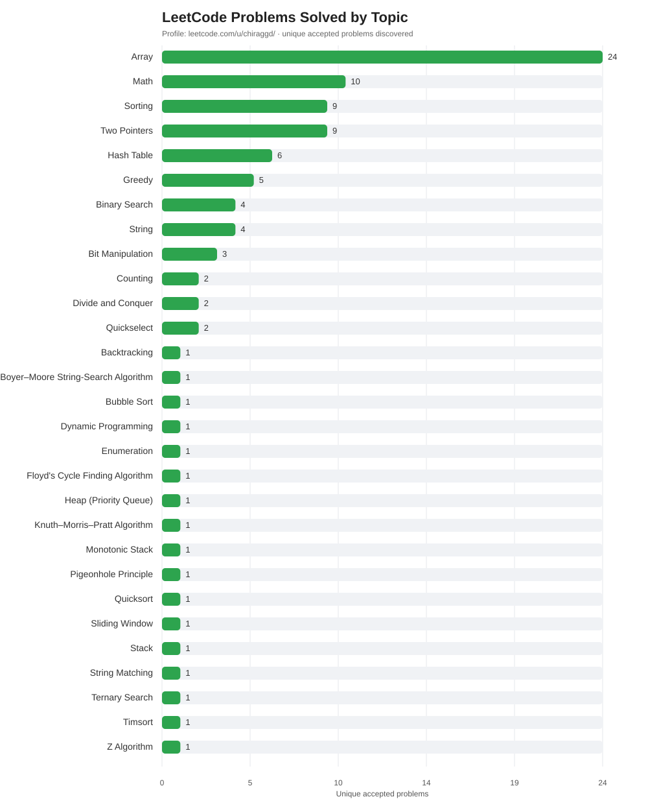

# LeetCode Topic Progress

My LeetCode profile: https://leetcode.com/u/chiraggd/

## Problems Solved by Topic

## How the chart updates

A GitHub Actions workflow runs daily and can also be started manually from the **Actions** tab.
It discovers accepted submissions exposed by LeetCode's public recent-submissions endpoint,
looks up each problem's topic tags, remembers discovered problems in `solved_problems.json`,
and regenerates the SVG.

**Coverage limitation:** LeetCode's public recent-accepted-submissions endpoint only exposes a
limited recent list. The workflow accumulates problems it sees over time; it cannot guarantee
that it will reconstruct every problem solved before the tracker was installed. Keep the workflow
enabled and check the Actions log for any LeetCode API errors.

## Files

- `update_leetcode_topics.py` — fetches submission data and generates the chart
- `topic_counts.json` — topic counts derived from discovered unique accepted problems
- `solved_problems.json` — cumulative list of problems the workflow has discovered
- `leetcode-topics.svg` — chart embedded above
- `.github/workflows/update-leetcode-topics.yml` — daily and manual workflow
